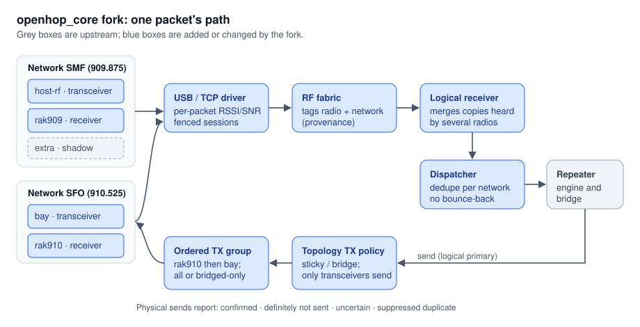

# OpenHop Core: HydraHop fork

This is Kesh's fork of [OpenHop Core](https://github.com/openhop-dev/openhop_core), the Python MeshCore protocol and radio library. It supplies the multi-radio layer for [Kesh's OpenHop Repeater fork](https://github.com/kesh33w/openhop_repeater), which bridges two MeshCore networks on different frequencies from one Raspberry Pi.

| | |
|---|---|
| **Main line** | [`kesh/bridge`](https://github.com/kesh33w/openhop_core/tree/kesh/bridge): what production runs |
| **Releases** | Released together as **HydraHop** (`hydrahop-vX.Y.Z` tags). Current version and pins: [hydrahop](https://github.com/kesh33w/hydrahop#readme). Changes: [CHANGELOG.md](CHANGELOG.md) |
| **Upstream base** | `openhop-dev/openhop_core` `dev` at `141d944` (19 Oct 2026) |
| **Used by** | [openhop_repeater `kesh/bridge`](https://github.com/kesh33w/openhop_repeater), which depends on this branch by git URL |

`pip install openhop-core` installs **upstream**, which lacks modules the repeater fork imports. Install from this repository instead (see below).

## What this fork changes



| Area | Change | Where |
|---|---|---|
| **Network topology** | Two named logical networks, each with one designated transmitter, plus `receiver` and `shadow` radios. Receptions keep their physical radio and network, and the TX policy (`sticky`, `bridge`, `default`) is checked per network. | `rf_fabric/topology.py` |
| **Logical receivers** | Copies of a packet heard by several radios on one network become a single reception that remembers every radio that heard it. | `rf_fabric/logical_receiver.py` |
| **Ordered TX groups** | One logical packet goes out through two radios on the same network in a fixed order, one after the other. A group can apply to every send or to bridged sends only (`tx_group_scopes`), with an optional random pause between the sends (`tx_group_gaps_ms`) and an optional random order (`tx_group_orders`). Shadow radios cannot join a group. | `rf_fabric/ordered_tx.py`, `topology.py`, `fabric.py` |
| **Per-network duplicate suppression** | Separate per network and per receive role. A packet this node carried into a network is never forwarded back to the network it came from. | `node/dispatcher.py` |
| **Transmit outcomes** | Every send ends as *confirmed*, *definitely not sent* (safe to retry) or *uncertain* (never retried). Suppressed duplicates are reported as suppressed, not failed. | `hardware/usb_radio.py`, `tcp_radio.py`, `dispatcher.py` |
| **USB modem robustness** | Serial I/O runs on its own threads, and stale sessions are fenced off. Each packet keeps its own RSSI and SNR. The command lock can't leak. Reconnects happen only after repeated CAD timeouts. | `hardware/usb_radio.py` |
| **CAD control** | Per-radio CAD on/off, applied only after the modem acknowledges. When a channel check fails, the packet is sent anyway, as upstream does. | `hardware/cad_control.py`, [docs/cad-control.md](docs/cad-control.md) |
| **Raw receive receipts** | Ordered, fenced receipts for a local bot's raw RF fallback. | `hardware/rx_receipts.py` |
| **Reception capture** | Opt-in JSONL capture of RX and TX events for comparing antennas (`OPENHOP_RX_CAPTURE_PATH`). | `rf_fabric/capture.py` |
| **Private-peer provenance** | Internet Link packets carry their origin and expiry without any change to the wire packet. | `protocol/packet.py`, `dispatcher.py` |

All of this is inactive unless the repeater configures a topology. A single-radio node behaves like upstream.

## Install and test

```sh
git clone --branch kesh/bridge https://github.com/kesh33w/openhop_core.git
cd openhop_core
python3 -m venv .venv
.venv/bin/pip install -e '.[dev,hardware]'
.venv/bin/pre-commit run --all-files     # black, isort, flake8, full test suite
```

Python 3.10 or later is required; CI tests 3.10 and newer. The `radio` extra adds serial support, and the `hardware` extra adds SPI, GPIO and USB. Unit tests need no radio attached.

To deploy the whole system, follow the hub's [upgrade guide](https://github.com/kesh33w/hydrahop/blob/kesh/openhop-bridge/docs/upgrade.md). Development workflow, branching and releases are described in the repeater's [CONTRIBUTING.md](https://github.com/kesh33w/openhop_repeater/blob/kesh/bridge/CONTRIBUTING.md), which covers all four repositories. This repo's [CONTRIBUTING.md](CONTRIBUTING.md) lists the core-specific points.

## Limits

- A modem's confirmation that it transmitted is not proof that anyone received the packet.
- This library does not make cross-channel translation end-to-end encrypted. The repeater decrypts and re-encrypts.
- Unit tests do not establish RF range, regulatory compliance or field reliability.

## Upstream and license

OpenHop Core supplies the underlying Python implementation, and [MeshCore](https://github.com/meshcore-dev/MeshCore) the original C++ protocol. The [upstream documentation](https://docs.openhop.dev/projects/openhop-core/) covers general library use. The original copyright notices and [MIT License](LICENSE) are unchanged.

Report fork-specific problems in the [hub's issues](https://github.com/kesh33w/hydrahop/issues), which cover all four repositories of this fork. Include the commit, the radio backend and steps to reproduce, and leave out channel keys and device credentials. For security problems see [SECURITY.md](SECURITY.md).
